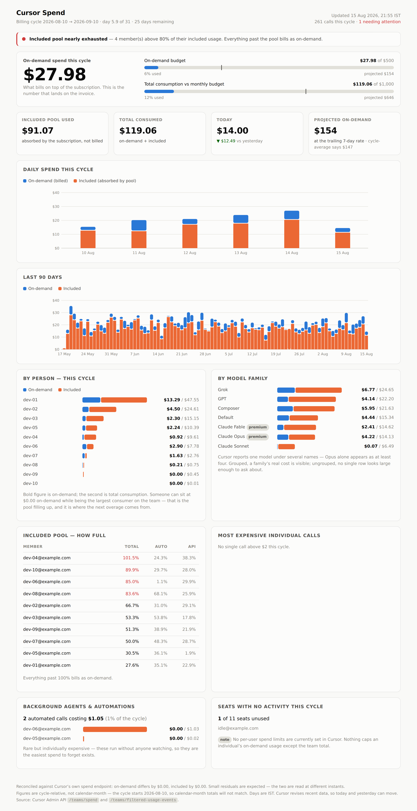
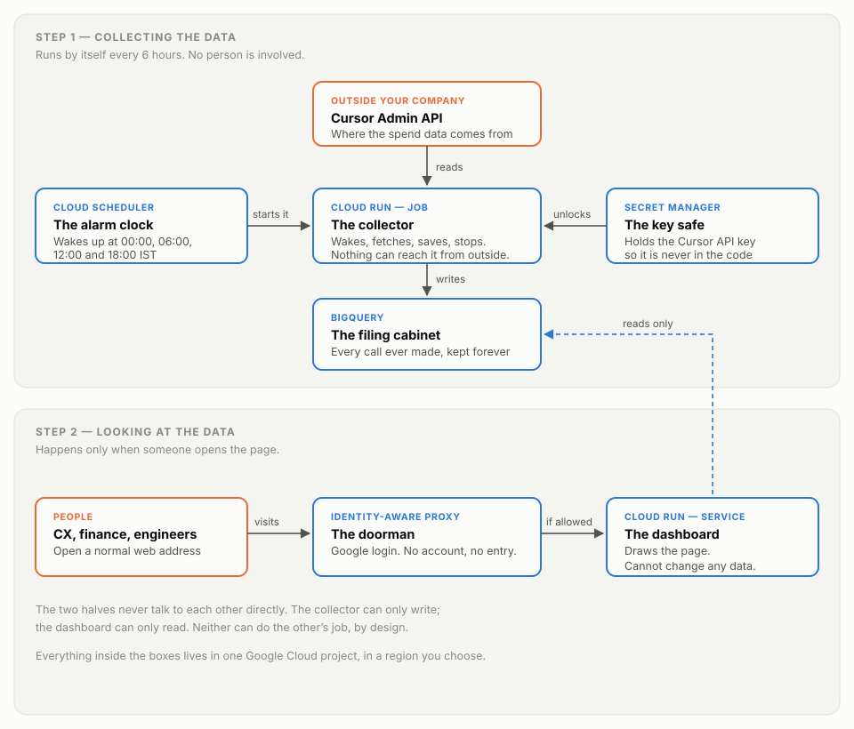

# Cursor Spend Dashboard

Self-hosted cost monitoring for [Cursor](https://cursor.com) team plans. Shows
what you're actually billed, what your included pool absorbed, who's spending,
and where the next overage is coming from — before it lands on an invoice.

Node.js · BigQuery · Google Cloud Run · no runtime dependencies beyond one client library



---

## Why this exists

A team discovers a $3,000 spike in AI tooling **ten days after it starts**, from
a screenshot someone posted in chat. By then the money is spent. Cursor's own
console shows you the current cycle and nothing else — no history, no trend, no
forecast, no alerting.

This turns that into a page that updates itself four times a day.

## The problem that makes this non-trivial

Cursor bills you **two different ways**, and only one reaches the invoice:

| `kind` | What it means | Shows on the bill? |
|---|---|---|
| `Usage-based` | Billed on top of the subscription | **Yes** |
| `Included in Business` | Absorbed by the prepaid pool | No — until the pool runs dry |

A dashboard showing only on-demand spend is showing you the *symptom*, and only
after the disease. In the data this was built against, on-demand was **$X** while
included consumption was **3.2× larger** — and the single biggest consumer of
value on the team showed **$0.00 on-demand**. Sort by "who is spending money" and
that person appears last. They were, in fact, first.

Once the pool empties, *everything* they do starts billing. That's the spike,
and it is fully visible weeks earlier if you're watching the right number.

**So every view here carries both figures.** Blue is billed, orange is absorbed,
everywhere, without exception.

---

## The docs disagree with the API

Cursor's Admin API documentation is wrong in several places that each produce
incorrect numbers. Everything below was verified against a live team account
rather than read off a doc page — `scripts/explore-api.mjs` and
`scripts/reconcile-api.mjs` are the scripts that established it.

| Reality | Why it matters |
|---|---|
| `overallSpendCents` is documented but **never returned** | Build a tile on it and you get `undefined` |
| `includedSpendCents`, `billingTier`, `autoPercentUsed`, `apiPercentUsed`, `totalPercentUsed` are returned but **undocumented** | The most useful early-warning fields aren't in the docs at all |
| `timestamp` is epoch milliseconds **as a string** | `new Date(e.timestamp)` throws `RangeError` |
| `serviceAccountId` is the literal string `"null"` when unset | It's **truthy** — a naive check reports 100% of calls as service accounts |
| `chargedCents` ≠ `tokenUsage.totalCents + cursorTokenFee` | Held for 953 of 1,208 sampled events, broke for 255. Never recompute it |
| The billing cycle starts at the subscription's **creation time of day**, not midnight | Anchoring on midnight pulls hours of the previous cycle into every total |
| `/teams/spend` has no history and no date parameters | It's a point-in-time snapshot. Not saving it means that moment is gone forever |

Rate limits are 60/min on `filtered-usage-events` and 20/min elsewhere; the
client throttles with 15% headroom and backs off on `429`.

---

## Quick start

```bash
npm install
cp .env.local.example .env.local     # add your Cursor Team Admin API key
npm run backfill                     # loads all available history
npm start                            # http://localhost:8080
```

> **Team Admin key, not User API key.** Cursor has two credentials that both say
> "Admin". A *User API Key* with scope `Admin` is for the Agent CLI and returns
> `401 Invalid Team API Key` on every `/teams/*` endpoint. You need a **Team
> Admin API key**, which only a team admin can create.

Useful scripts:

```bash
npm run explore     # discover your team's response shapes and retention window
npm run reconcile   # verify the on-demand/included split against /teams/spend
npm test            # 37 offline checks, no network or API key required
npm run ingest      # refresh now
```

---

## Architecture



Two Cloud Run resources, deliberately:

```
Cloud Scheduler ──6h──▶ Cloud Run JOB (ingest)  ──writes──▶ BigQuery
                                                                │
       users ──▶ IAP ──▶ Cloud Run SERVICE (dashboard) ──reads──┘
```

**Why split?** Identity-Aware Proxy intercepts inbound requests and replaces the
caller's identity. A scheduler calling an IAP-protected service means punching a
hole in the thing protecting it. Splitting them gives the ingest job **no inbound
network path at all**, and gives the dashboard **no write path**. It is also less
code than any of the workarounds.

Deploy:

```bash
./deploy/setup.sh  YOUR_PROJECT_ID     # once: APIs, service account, dataset, secret
./deploy/deploy.sh YOUR_PROJECT_ID     # every push
./deploy/grant.sh  YOUR_PROJECT_ID group:your-group@yourcompany.com
```

Running cost is effectively zero — everything scales to zero and the data volume
(~8k events/month) sits well inside BigQuery's free tier.

📖 [How it works, in plain English](docs/ARCHITECTURE.md) · [Full project reference](docs/PROJECT-REFERENCE.md)

---

## Design decisions

**No chart library, no framework, no build step.** Charts are inline SVG rendered
server-side. The page works with JavaScript disabled. A dashboard that gets
presented to leadership shouldn't be able to fail because a CDN script tag didn't
resolve — and hand-rolling bars is less code than configuring a chart library to
look right.

**One aggregation implementation, not one per storage backend.** Both the file
and BigQuery drivers return raw rows; every metric is computed in JavaScript. A
SQL version of the same arithmetic would be a second place for the numbers to
disagree.

**Idempotency by whole-day replacement.** Usage events carry no stable ID, so any
dedup key would be a guess. Re-ingesting a day deletes and rewrites it. This also
solves a second problem for free: Cursor revises recent data, and an
append-only design would bake provisional numbers in permanently.

**Two forecasts, always shown together.** One extrapolates the cycle average, the
other the trailing 7-day rate. When they diverge sharply, *that divergence is the
signal* — something changed recently that the long-run average is still hiding.

**Model families are grouped.** Cursor reports one model under several names —
Opus alone appears as at least four. Ungrouped, a family's real cost scatters
across rows that each look too small to ask about.

---

## Testing

```bash
npm test
```

37 checks, no network required:

- **Normalisation** — string timestamps, the `"null"` string, on-demand/included partition
- **Time** — IST day boundaries, UTC leakage, cycle anchoring on the API value
- **Conservation** — every breakdown must re-sum to the total
- **Storage** — day-replacement idempotency, cross-month reads, snapshot ordering
- **Rendering** — full document, no `NaN`, empty-store path

Both bugs found during development are pinned as permanent fixtures. Test data is
synthetic and fictional.

## Stack

| | |
|---|---|
| Runtime | Node.js 22+, ES modules, no transpiler |
| Server | `node:http` — no framework |
| Charts | Hand-written inline SVG, server-rendered |
| Storage | BigQuery (cloud) or JSON files (local), one interface |
| Deploy | Cloud Run × 2, Cloud Scheduler, Secret Manager, IAP |
| Dependencies | One: `@google-cloud/bigquery`, lazily imported |

## Licence

MIT — see [LICENSE](LICENSE).
