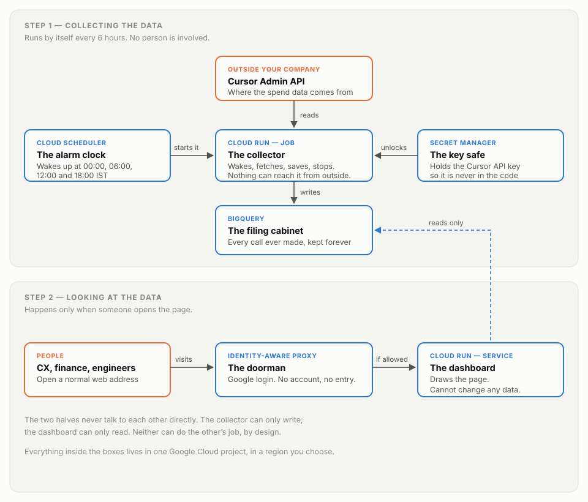

# How the Cursor Spend Dashboard Works

**A plain-English explanation.** No engineering background needed.

*An open-source spend dashboard for Cursor team plans*

---

## What this is

A web page that shows how much the team is spending on Cursor — today, this
billing cycle, per person, per model — and warns you when spending is heading
somewhere you don't want it to go.

It exists because the usual way teams discover an AI spending spike is a
screenshot in a chat channel, a week or two after it started. By then the money
is gone. This makes that impossible: the numbers update by themselves four times
a day, and anyone who needs them can look without asking anyone.

---

## The one idea you need to understand

Cursor bills you **two different ways**, and only one of them shows up on the
invoice. Nearly every confusing thing about Cursor spending comes from mixing
these up.

Think of it like a mobile phone plan:

| | Phone plan | Cursor |
|---|---|---|
| **Your included allowance** | The data included in your monthly plan | The "Business pool" that comes with your subscription |
| **What you pay extra for** | Going over your data cap | On-demand usage, once the pool is empty |

Now the important part. **If you only watch the extra charges, you are watching
the wrong number.** Your bill looks fine right up until the allowance runs out,
and then it doesn't. By the time the extra charges appear, the overspending
already happened.

In one real billing cycle this was measured against, the included usage was
**3.2 times larger** than the on-demand spend. And the single biggest consumer of
value on the team showed **$0.00** of on-demand spend — on a list sorted by "who
is spending money," they came last. They were, in fact, first.

When their allowance runs out, everything they do starts billing at once. That is
the spike, and it is visible weeks in advance if you watch the right number.

**So this dashboard always shows both numbers, side by side, everywhere.**
Blue is what you're billed for. Orange is what the allowance absorbed. Watching
only the blue is how you get surprised.

---

## The picture

---

## How it works, in two steps

### Step 1 — Collecting the data (automatic, every 6 hours)

Nobody does anything. Four times a day — midnight, 6am, noon and 6pm IST — this
happens by itself:

1. **An alarm clock goes off.** Google's Cloud Scheduler is set to fire every
   six hours.
2. **It starts the collector.** A small program wakes up. It exists only for the
   couple of minutes it takes to do its job, then shuts down completely.
3. **The collector unlocks the key safe.** The password that lets us read
   Cursor's data is kept in a separate locked vault, not written into the
   program. The collector borrows it, uses it, and never keeps a copy.
4. **It asks Cursor for the data.** Every AI call the team made — who, when,
   which model, what it cost.
5. **It files everything away** in a database that keeps it forever.
6. **It shuts down.** Nothing is left running. This costs almost nothing because
   you only pay for the two minutes it was awake.

### Step 2 — Looking at the data (only when someone opens the page)

1. **Someone opens the web address.**
2. **A doorman checks them.** Google's Identity-Aware Proxy asks them to sign in
   with their company Google account. No account, no entry — there is no
   password to share, leak, or forget to revoke when someone leaves.
3. **If they're on the list, the page loads.** It reads the numbers out of the
   database, does the arithmetic, draws the charts, and sends back a page.
4. **When nobody's looking, nothing is running.** Cost drops to zero between
   visits.

---

## The cast, in plain terms

| What we call it | What it actually is | Its one job |
|---|---|---|
| **The alarm clock** | Cloud Scheduler | Says "go" every six hours |
| **The collector** | Cloud Run Job | Fetches data from Cursor and files it |
| **The key safe** | Secret Manager | Holds the Cursor password securely |
| **The filing cabinet** | BigQuery | Keeps every record, forever |
| **The doorman** | Identity-Aware Proxy | Checks who you are before letting you in |
| **The dashboard** | Cloud Run Service | Draws the page you look at |

---

## Two decisions worth explaining

### Why the collector and the dashboard are separate programs

It would seem simpler to have one program that both fetches data and shows it.
It isn't, for two reasons.

**The security reason.** The doorman works by intercepting every incoming
request and checking the person's identity. But the alarm clock isn't a person —
it has no Google account to check. If the alarm clock had to knock on the same
door as everyone else, we would have to punch a hole in the door for it. That
hole is exactly the kind of thing that gets forgotten and later exploited.

By splitting them, the collector has **no door at all**. Nothing on the internet
can reach it. Only the alarm clock, from inside Google's own systems, can start
it.

**The safety reason.** The dashboard is the part that people touch, so it's the
part most likely to have a bug or be poked at. It has been given **no ability to
write anything** — it can only read. Even if something went badly wrong with the
page, it cannot corrupt or delete a single record.

### Why we keep our own copy of the data

Cursor's own "current spend" figure has no history. It tells you what you've
spent *right now*, in *this* cycle, and nothing else. You cannot ask it what
last Tuesday looked like.

So every time the collector runs, it takes a snapshot and keeps it. Each one is
a data point that can never be recovered later — if we don't save it today, that
moment is gone forever. That's what makes the trend lines and the forecast
possible at all.

Fortunately, the detailed call-by-call records **do** go back about ten months,
so the dashboard had real history from day one rather than starting blank.

---

## What the dashboard tells you

- **The big number** — on-demand spend this cycle. The invoice figure.
- **Two budget bars** — against your on-demand cap and your total budget, both
  set by configuration.
- **Today, and the change since yesterday.**
- **A forecast, calculated two ways.** One uses the whole cycle's average; the
  other uses only the last seven days. When those two numbers disagree sharply,
  *that disagreement is the warning* — it means something changed recently that
  the long-run average is still hiding.
- **Who is spending** — both numbers, per person.
- **Which models** — grouped by family, because Cursor reports the same model
  under several different names and the cost otherwise looks scattered across
  rows that each seem too small to worry about.
- **How full the allowance is** — per person. This is the early warning.
- **Background agents** — automated tasks that run with nobody watching. Rare,
  but individually the most expensive calls on the platform.
- **Unused seats** — people paying for Cursor who haven't used it this cycle.
- **Alerts** — plain-English warnings at the top when something needs attention.

---

## When something goes wrong

**The numbers look stale.** The page shows when it last updated. If that's more
than six hours ago, the collector didn't run — check its logs in Google Cloud.

**The numbers look wrong.** The page checks itself. On every load it compares
its own arithmetic against Cursor's official figure and prints the difference in
the footer. A small gap is normal — the two are read seconds apart. A large gap
gets flagged in red, so you find out from the page rather than from someone in
the meeting.

**Today's number went down.** Cursor revises recent data for a day or two. The
collector re-fetches the last few days every run and replaces them wholesale
rather than adding to them, so corrections fix themselves.

**Cursor changes their API.** The collector fails loudly and the dashboard keeps
showing the last good data with an old timestamp. It does not silently show
wrong numbers.

---

## What it costs to run

Effectively nothing — a few dollars a month at most, and quite possibly zero.

Everything is billed by actual use. The collector runs for about two minutes,
four times a day. The dashboard runs only while someone is looking at it. The
database holds around 35,000 records, which is far inside Google's free tier.

There is a certain irony in a cost-monitoring tool that costs money, so it's
worth being precise: this is in the *tens of cents to a few dollars* per month
range, not the tens of dollars range.

---

## What it deliberately does not do

- **It cannot change anything in Cursor.** It only reads. It cannot set limits,
  remove members, or alter anyone's account.
- **It does not send alerts anywhere.** Warnings appear on the page. Slack and
  email notifications were left out of this first version on purpose.
- **It does not track code quality or productivity.** The data is available, but
  this is a spending tool.
- **It does not use AI.** Nothing in the running system calls a language model.
  It is arithmetic on numbers Cursor gives us.
